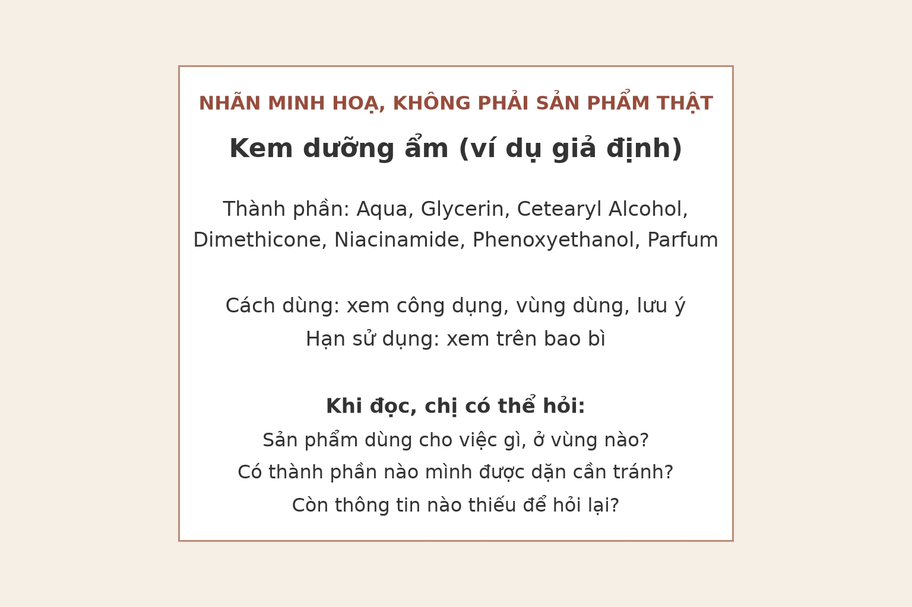

Chị muốn đọc bảng thành phần mỹ phẩm để chọn kỹ hơn, nhưng một hàng tên dài khiến việc chăm da giống bài kiểm tra hoá học. Giang nghĩ chị không cần thuộc hết. Điều hữu ích hơn là biết nhãn trả lời được câu nào và câu nào vẫn cần hỏi thêm.

## Đọc bảng thành phần mỹ phẩm để làm gì?

Nếu chị đang chọn đồ cho da mụn, bài [chăm da mụn tại nhà](/bai/cham-da-mun-tai-nha/) giúp đặt việc đọc nhãn vào một chu trình cụ thể.

Trước hết, chị hãy viết một câu về nhu cầu của mình. Ví dụ giả định: “Tôi cần một sản phẩm dưỡng ẩm và muốn tránh thành phần bác sĩ từng xác định gây dị ứng cho tôi.” Câu đó giúp việc đọc nhãn có đích đến rõ hơn so với tìm một công thức không có bất kỳ chữ lạ nào.

Sau đó, tách ba phần trên bao bì: tên và lời giới thiệu ở mặt trước, danh sách thành phần, hướng dẫn sử dụng. Mỗi phần có một nhiệm vụ. Lời giới thiệu giúp chị biết hãng muốn nói gì; hướng dẫn cho biết cách hãng yêu cầu dùng; danh sách cho biết tên các thành phần được khai báo.

Đừng để một chữ nổi bật ở mặt trước thay cho việc đọc hai phần còn lại. Chị cũng không cần chụp màn hình từng thành phần rồi cộng tất cả lời mô tả công dụng thành hiệu quả của cả chai.

## Thứ tự thành phần có cho biết nồng độ không?

Hướng dẫn ghi nhãn của FDA tại Hoa Kỳ quy định cách liệt kê giảm dần theo lượng, với ngoại lệ như thành phần ở mức 1% trở xuống và chất màu. Vì có ngoại lệ, vị trí trong danh sách không cho phép suy ra phần trăm chính xác. Đây là phạm vi hướng dẫn Hoa Kỳ, không phải kết luận về toàn bộ quy định tại Việt Nam. [FDA: Cosmetics Labeling Guide (Hoa Kỳ)](https://www.fda.gov/cosmetics/cosmetics-labeling-regulations/cosmetics-labeling-guide)

Ví dụ giả định, một nhãn ghi “A, B, C, D”. Chị chưa biết ranh giới nhóm thành phần có lượng thấp nằm ở đâu. Do đó, chị không thể đổi câu “C đứng thứ ba” thành “C chắc có nồng độ đủ để xử lý vấn đề da của tôi”.

Tương tự, một thành phần đứng gần cuối chưa đủ để kết luận sản phẩm chỉ dùng nó làm quảng cáo. Cần thông tin về công thức và dữ liệu phù hợp, thay vì đoán bằng mắt. Với chị em bận rộn, biết giới hạn này giúp bỏ bớt một công việc không cần thiết: cố tính ra công thức từ một danh sách vốn không cho đủ dữ kiện.

## Tên khó đọc và mùi hương có đáng lo không?

Giang đề xuất chị tra đúng tên ghi trên nhãn, không tự rút gọn vì hai từ trông gần giống nhau. Nếu nhãn nhỏ, hãy chụp rõ hoặc tìm bản công bố chính thức của chính sản phẩm ấy. Một ảnh mờ được phóng to vẫn có thể khiến chị đọc nhầm.

Riêng mùi hương, AAD phân biệt sản phẩm không hương liệu với sản phẩm không mùi: loại ghi không mùi, hoặc có thành phần từ thực vật, vẫn có thể chứa thành phần liên quan đến hương liệu. Khi hay phản ứng, chị nên trao đổi về việc chọn sản phẩm không hương liệu. [AAD: Thử sản phẩm chăm da](https://www.aad.org/public/everyday-care/skin-care-secrets/prevent-skin-problems/test-skin-care-products)

Điều đó không có nghĩa chỉ cần nhìn thấy một tên liên quan đến hương liệu là biết chắc chị sẽ bị dị ứng. Nhật ký phản ứng của chính chị và đánh giá của bác sĩ có ích hơn một danh sách cấm truyền tay cho tất cả mọi người.

## Có thể đọc nhãn theo trình tự nào cho đỡ rối?

Chị có thể thử cách sắp xếp này cho một sản phẩm đang cân nhắc:

1. Đọc sản phẩm dành cho việc gì và dùng ở vùng nào.
2. Xem cách dùng, lưu ý và hạn sử dụng được ghi trên bao bì.
3. Tìm tên thành phần mình đã được xác định cần tránh, nếu có.
4. Đánh dấu những thông tin còn thiếu để hỏi nơi cung cấp hoặc bác sĩ.

Đây là gợi ý đọc thông tin của Giang, không phải quy trình chứng nhận một mỹ phẩm an toàn. Nếu không tìm thấy điều chị cần biết, chị có thể chưa mua. Không phải nhãn nào cũng cần được giải mã ngay để chị có một chu trình chăm sóc đủ dùng.

Một tờ ghi chú chỉ cần ba cột: tên sản phẩm, điều đã biết, điều còn hỏi. Không cần chấm điểm công thức. Cách ấy cũng giúp chị trao đổi rõ hơn khi được tư vấn: “Tôi từng phản ứng với món này” có thông tin cụ thể hơn “da tôi rất khó chiều”.

*Nhãn minh hoạ, không phải sản phẩm thật*

## Đọc xong vẫn cần thử và theo dõi ra sao?

Nhãn phù hợp chưa cho biết chắc [phản ứng của da chị](/bai/kien-nhan-khi-cham-da/). AAD hướng dẫn bôi thử hai lần mỗi ngày ở vùng nhỏ mặt trong cánh tay hoặc khuỷu tay trong 7-10 ngày. Với sản phẩm rửa trôi như sữa rửa mặt, để trên vùng thử khoảng 5 phút hoặc theo hướng dẫn của sản phẩm rồi rửa đi. Đây là cách thử trên vùng nhỏ, không phải yêu cầu để sữa rửa mặt 5 phút trên toàn mặt mỗi lần rửa. Nếu có phản ứng, ngừng dùng và tìm hỗ trợ khi cần. [AAD: Thử sản phẩm chăm da](https://www.aad.org/public/everyday-care/skin-care-secrets/prevent-skin-problems/test-skin-care-products)

Nếu bác sĩ đang cho chị dùng thuốc, hãy hỏi trước khi đưa mỹ phẩm mới vào chu trình. Không lấy hướng dẫn thử mỹ phẩm chung áp vào mọi thuốc hoặc sản phẩm peel.

Giang mong việc đọc nhãn giúp chị bớt hoang mang. Chị có quyền chưa biết một tên thành phần và có quyền hỏi lại. Một lựa chọn có suy nghĩ đôi khi đơn giản là giữ món đang hợp, chưa vội thêm món mà mình chưa hiểu.

Bài viết chia sẻ thông tin chăm sóc da phổ thông, không thay thế khám và tư vấn của bác sĩ da liễu.

## Nguồn tham khảo

- [FDA: Cosmetics Labeling Guide (Hoa Kỳ)](https://www.fda.gov/cosmetics/cosmetics-labeling-regulations/cosmetics-labeling-guide)
- [AAD: Thử sản phẩm chăm da](https://www.aad.org/public/everyday-care/skin-care-secrets/prevent-skin-problems/test-skin-care-products)
