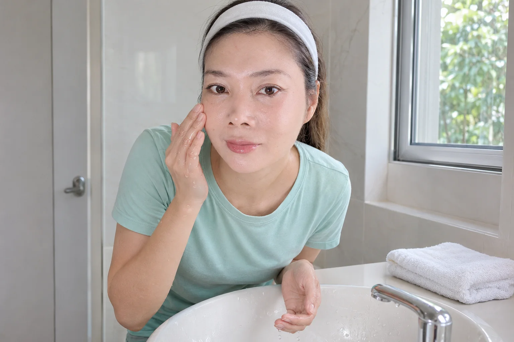

Chị rửa mặt đều mà mụn vẫn xuất hiện, muốn chăm thêm lại sợ da bí và rát? Với **chăm da mụn tại nhà**, Giang muốn cùng chị gỡ từng việc: hiểu vì sao da nổi mụn, chọn cách chăm vừa sức và biết lúc nào nên đi khám.

## Vì sao rửa mặt rồi da vẫn nổi mụn?

Mụn có thể xuất hiện khi dầu thừa và tế bào chết làm tắc nang lông. Vi khuẩn trong nang lông bị bít có thể góp phần gây viêm. Vì thế, chỉ làm sạch bề mặt chưa giải quyết được toàn bộ quá trình hình thành mụn. [NHS: Acne](https://www.nhs.uk/conditions/acne/)

Rửa nhiều hơn không có nghĩa là chăm tốt hơn. Việc rửa liên tục trong ngày còn có thể khiến da kích ứng và nổi thêm mụn. [AAD: Những thói quen làm mụn nặng hơn](https://www.aad.org/public/diseases/acne/skin-care/habits-stop)

Mụn cũng không chỉ có ở tuổi dậy thì. Người trưởng thành vẫn có thể bị mụn, kể cả trước đó ít gặp; nội tiết là một yếu tố có vai trò trong quá trình này. Tuy nhiên, không thể từ vài nốt trên mặt mà tự xác định nguyên nhân riêng của chị. [AAD: Nguyên nhân gây mụn](https://www.aad.org/public/diseases/acne/causes/acne-causes)

Giang mong chị bớt trách mình đã chăm chưa đủ kỹ. Câu hỏi hữu ích hơn là: hiện tại chị đang dùng những gì, da phản ứng ra sao, có nốt đau hay sẹo không? Những điều cụ thể ấy giúp cuộc trao đổi về da rõ ràng hơn lời nhận xét “da em xấu quá”.

## Các bước chăm sóc da mụn tại nhà nên bắt đầu thế nào?

Giang gợi ý sắp xếp việc chăm da theo ba phần dưới đây. Đây là cách ghi nhớ các việc cơ bản, không phải phác đồ điều trị dùng chung cho mọi người.

1. **Làm sạch nhẹ.** Rửa mặt tối đa hai lần mỗi ngày và sau khi đổ nhiều mồ hôi. Chọn sản phẩm dịu, không có hạt chà; dùng đầu ngón tay thay vì kỳ cọ bằng dụng cụ. [AAD: Chăm sóc da mụn](https://www.aad.org/public/diseases/acne/skin-care/tips)
2. **Xem nhu cầu dưỡng ẩm.** Nếu da khô, nhất là trong lúc điều trị, dưỡng ẩm phù hợp có thể giúp giảm khô và hỗ trợ khả năng dung nạp thuốc. [AAD: Dưỡng ẩm khi có mụn](https://www.aad.org/public/diseases/acne/skin-care/moisturizer)
3. **Bảo vệ khỏi nắng.** Khi ra ngoài, kết hợp bóng râm, quần áo che chắn và kem chống nắng phổ rộng, kháng nước, SPF từ 30. Ưu tiên loại ghi không gây bít tắc. [AAD: Chăm sóc da mụn](https://www.aad.org/public/diseases/acne/skin-care/tips)

Để dễ nhớ trong ngày bận, chị có thể ghi việc buổi sáng và buổi tối lên một tờ giấy nhỏ. Nếu có trang điểm, nhớ tẩy trang cuối ngày. [NHS: Acne](https://www.nhs.uk/conditions/acne/)

Giang không muốn đưa cho chị thêm một danh sách mua sắm. Hãy bắt đầu bằng việc đọc lại nhãn những món đang có. Món nào là làm sạch, món nào dưỡng, món nào là thuốc? Nếu không rõ cách dùng thuốc đang được kê, chị hỏi lại người kê đơn trước khi tự xếp thêm bước.

*Ảnh minh hoạ tạo bằng AI*

## Da mụn có nên dùng kem dưỡng ẩm không?

Có mụn không đồng nghĩa phải bỏ dưỡng. Khi da đang khô, dưỡng ẩm sau rửa giúp giữ nước trong da. Chị có thể tìm các nhãn như “oil-free”, “non-comedogenic” hoặc “won't clog pores”; đây là gợi ý lựa chọn, không phải bảo đảm sản phẩm hợp với tất cả mọi người. [AAD: Dưỡng ẩm khi có mụn](https://www.aad.org/public/diseases/acne/skin-care/moisturizer)

Điểm cần tách rõ là **dưỡng ẩm hỗ trợ chăm sóc**, còn điều trị mụn có mục tiêu riêng. Không nên lấy việc da bớt khô làm bằng chứng rằng chỉ cần kem dưỡng là đủ xử lý mụn. Nguồn của AAD cũng đặt dưỡng ẩm trong bối cảnh phối hợp với điều trị. [AAD: Dưỡng ẩm khi có mụn](https://www.aad.org/public/diseases/acne/skin-care/moisturizer)

Nếu còn phân vân, chị thử viết câu hỏi thật cụ thể: “Da tôi khô ở đâu, đang dùng thuốc gì, dưỡng xong có khó chịu không?”. Giang thích cách đặt câu hỏi này vì chị sẽ dễ diễn đạt điều mình cần được giúp hơn là chỉ hỏi nên mua loại nào.

## Sợ bí da thì có nên bỏ chống nắng?

Da đang có mụn vẫn cần bảo vệ trước nắng. Một số thuốc trị mụn còn làm da nhạy cảm hơn với tia cực tím. Chị hãy chọn kem chống nắng dành cho da dễ nổi mụn, kết hợp che chắn thay vì chỉ dựa vào một lớp kem. [AAD: Chăm sóc da mụn](https://www.aad.org/public/diseases/acne/skin-care/tips)

Về cách duy trì, Giang gợi ý chị đặt mũ cạnh túi đi làm và để sản phẩm chống nắng ở nơi dễ nhớ. Những sắp xếp nhỏ này không phải mẹo điều trị; chúng chỉ giúp một việc cần làm bớt bị quên giữa buổi sáng nhiều việc.

Nếu sản phẩm hiện tại khiến chị ngại dùng, hãy ghi rõ điều bất tiện: khó tán, cảm giác nặng mặt hay có khó chịu trên da. Khi cần tư vấn, chị mang theo tên sản phẩm và mô tả ấy. Chị không cần cố khen một món chỉ vì người khác thấy hợp.

## Có nên nặn mụn, tẩy da chết hoặc đổi sản phẩm?

Không nên tự nặn mụn. Giang hiểu cảm giác nhìn thấy một nốt là muốn xử lý ngay, nhưng tự nặn có thể đẩy chất bên trong sâu hơn, làm viêm tăng và tăng nguy cơ đau, sẹo. Chà xát để mong da sạch hơn cũng có thể gây kích ứng. [AAD: Những thói quen làm mụn nặng hơn](https://www.aad.org/public/diseases/acne/skin-care/habits-stop)

Tự nặn còn có thể làm mụn lâu lành và tăng nguy cơ để lại thâm sau viêm. [AAD: Chăm sóc da mụn](https://www.aad.org/public/diseases/acne/skin-care/tips)

Vì vậy, bài này không hướng dẫn lấy nhân mụn hay lột tẩy tại nhà. Nếu da đang kích ứng, chị nên tránh chà hạt hoặc dùng sản phẩm tẩy khiến da khô, rát thêm. Các sản phẩm tẩy hoặc làm se gây kích ứng có thể làm da khô và mụn trông nặng hơn. [AAD: Chăm sóc da mụn](https://www.aad.org/public/diseases/acne/skin-care/tips)

Đổi cách trị mụn liên tục cũng dễ gây kích ứng. Điều trị cần thời gian; thấy chưa thay đổi ngay không phải lý do để mỗi tuần thử một thứ mới. [AAD: Những thói quen làm mụn nặng hơn](https://www.aad.org/public/diseases/acne/skin-care/habits-stop)

Thay vì tự đặt thêm một bước tối nay, chị có thể ghi lại ngày bắt đầu sản phẩm và những thay đổi mình nhận thấy. Đây là gợi ý theo dõi của Giang, không phải cách tự chẩn đoán. Khi da có dấu hiệu đáng lo, việc cần làm là tìm trợ giúp, không cố chịu để hoàn thành một lịch chăm da.

*Ảnh minh hoạ tạo bằng AI*

## Chăm da mụn tại nhà: khi nào cần khám da liễu?

Chị nên gặp bác sĩ khi mụn nhiều, có nốt sâu đau, để sẹo, hoặc đã thử chăm sóc và điều trị nhưng không cải thiện. Da nóng, sưng, đỏ cần được đánh giá vì có thể là dấu hiệu nhiễm trùng. Mụn ảnh hưởng tinh thần cũng là lý do chính đáng để đi khám. [NHS: Khi nào cần trợ giúp](https://www.nhs.uk/conditions/acne/)

Chị không cần đợi da thật nặng mới cho phép mình tìm người hỗ trợ. Nếu đang tránh gặp bạn bè hoặc thấy chuyện làn da chiếm quá nhiều tâm trí, hãy nói điều đó trong buổi khám. Đó là phần trải nghiệm của chị, không phải chuyện “chỉ có mấy nốt mụn” để bỏ qua.

Để buổi khám dễ trao đổi, Giang gợi ý mang danh sách sản phẩm, thuốc đang dùng và những câu hỏi còn vướng. Chị cũng có thể nói rõ quỹ thời gian chăm da mỗi ngày, để cùng bàn cách thực hiện phù hợp.

Với Giang, “Hiểu da · Chọn đúng · Làm đủ” bắt đầu từ việc hiểu giới hạn của tự chăm. Chị có thể dành cho làn da sự nhẹ nhàng, đồng thời nhờ bác sĩ khi cần. Hai việc ấy đi cùng nhau.

Bài viết chia sẻ thông tin chăm sóc da phổ thông, không thay thế khám và tư vấn của bác sĩ da liễu. Nếu có những dấu hiệu kể trên, chị nên đi khám để được đánh giá riêng.

## Nguồn tham khảo

1. [American Academy of Dermatology: Acne: Tips for managing](https://www.aad.org/public/diseases/acne/skin-care/tips).
2. [NHS: Acne](https://www.nhs.uk/conditions/acne/).
3. [American Academy of Dermatology: Moisturizer: Why you may need it if you have acne](https://www.aad.org/public/diseases/acne/skin-care/moisturizer).
4. [American Academy of Dermatology: 10 skin care habits that can worsen acne](https://www.aad.org/public/diseases/acne/skin-care/habits-stop).
5. [American Academy of Dermatology: Acne: Who gets and causes](https://www.aad.org/public/diseases/acne/causes/acne-causes).
