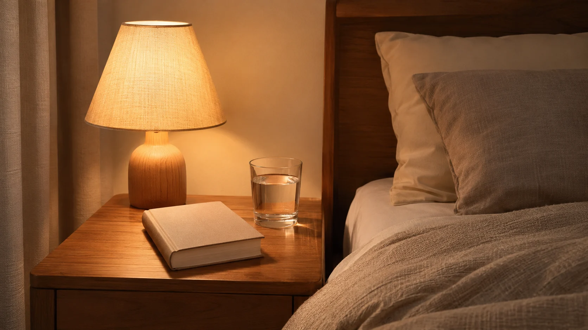

Chị lo giấc ngủ và làn da vì sáng soi gương thấy mình mệt, nhưng tối lại không dễ ngủ sớm hơn. Giang muốn nói về chuyện ngủ theo cách vừa sức: hiểu bằng chứng đến đâu, rồi tìm một thay đổi có thể làm trong hoàn cảnh của chị.

## Giấc ngủ và làn da: nghiên cứu thực sự nói gì?

Một nghiên cứu trên 60 phụ nữ da trắng ghi nhận mối liên hệ giữa chất lượng ngủ, dấu hiệu lão hoá nội tại và khả năng phục hồi hàng rào da. Đây là mẫu nhỏ, không đại diện cho mọi phụ nữ; nghiên cứu có tài trợ từ Estée Lauder và hai tác giả làm tại công ty này. [Oyetakin-White và cộng sự: Chất lượng giấc ngủ và lão hoá da](https://onlinelibrary.wiley.com/doi/10.1111/ced.12455)

Giang muốn chị đọc chữ “liên hệ” thật chậm. Nó không có nghĩa chỉ cần thay giờ ngủ thì tất cả chỉ số da sẽ đổi theo, cũng không chứng minh một đêm thiếu ngủ gây ra mảng nám trên mặt. Đây là điểm cần giữ khi một tiêu đề trên mạng biến nghiên cứu thành công thức làm đẹp.

Chị có thể xem giấc ngủ là điều đáng quan tâm vì sức khoẻ của mình, ngay cả khi chưa thấy bất kỳ thay đổi nào trên da. Không cần dùng ảnh trước và sau để chứng minh mình đã nghỉ ngơi đúng.

## Vì sao không nên giao hết việc chăm da cho giấc ngủ?

Một thói quen sinh hoạt và một kế hoạch điều trị da trả lời những câu hỏi khác nhau. Nếu đang dùng thuốc theo hướng dẫn, chị cần trao đổi việc thay đổi điều trị với bác sĩ. Không nên tự bỏ chỉ vì quyết tâm ngủ tốt hơn từ tuần này.

Giang cũng không muốn chị [nhận thêm lỗi về mình](/bai/cham-soc-ban-than-khong-ich-ky/). Có những đêm bị gián đoạn bởi chăm con, công việc hoặc hoàn cảnh không dễ thay đổi. Một lời khuyên “cứ ngủ sớm là đẹp” không giải quyết được người đang cần người khác san sẻ việc nhà.

Thay vì hỏi “tại sao mình không làm được”, chị có thể viết rõ trở ngại: cần làm việc đến muộn, uống cà phê chiều, hay thức vì phải xử lý tin nhắn. Gọi đúng tên việc đang xảy ra giúp bước tiếp theo cụ thể hơn.

## Có thể chuẩn bị buổi tối bằng những việc nào?

NHLBI khuyến nghị lịch ngủ thức tương đối đều, khoảng thời gian yên tĩnh trước ngủ, chú ý caffeine và môi trường ngủ tối, yên, mát. Người làm ca cần điều chỉnh theo lịch thực tế. Những hướng dẫn này nhằm hỗ trợ giấc ngủ, không phải cam kết hiệu quả làm đẹp. [NHLBI: Thói quen ngủ lành mạnh](https://www.nhlbi.nih.gov/health/sleep-deprivation/healthy-sleep-habits)

Từ đó, Giang gợi ý chị chọn một việc để thử, thay vì cùng lúc đổi cả buổi tối:

1. Xác định lúc nào có thể kết thúc phần việc không khẩn cấp.
2. Chuẩn bị trước những món sáng mai cần dùng để đỡ phải nghĩ lại trên giường.
3. Chọn một hoạt động yên tĩnh chị thực sự thích.
4. Ghi ngắn điều gì giúp hoặc cản trở việc nghỉ, rồi điều chỉnh.

Ví dụ giả định, nếu chị hay mở điện thoại để kiểm tra lịch hôm sau rồi mắc lại ở các tin nhắn, có thể thử ghi lịch ra giấy sớm hơn. Đây chỉ là gợi ý tổ chức công việc; chị không cần dùng thêm ứng dụng theo dõi nếu nó khiến mình bận hơn.

*Ảnh minh hoạ tạo bằng AI*

## Khi bận chăm con hoặc làm ca, bắt đầu ở đâu?

Giang nghĩ câu hỏi nên là “phần nào có thể được san sẻ” trước khi là “chị phải cố thêm điều gì”. Có thể chị cần một người thay ca chăm con, một khoảng giờ không nhận việc mới, hoặc phòng nghỉ ít tiếng động hơn.

Chị hãy đề nghị một việc cụ thể: người nhà phụ trách việc gì, trong khoảng thời gian nào. Một đề nghị rõ sẽ dễ trao đổi hơn mong mọi người tự hiểu mình đã mệt. Nếu chưa thể đổi lịch ngay, chị vẫn có thể ghi nhận nhu cầu ấy mà không tự chê mình thiếu kỷ luật.

Không có một buổi tối mẫu hợp cho mọi gia đình. Chị có thể bắt đầu với phần mình điều chỉnh được và nhờ hỗ trợ ở phần không tự xoay xở được.

## Khi nào giấc ngủ cần được hỗ trợ chuyên môn?

Nếu khó ngủ, mệt mỏi hoặc khó tập trung kéo dài và ảnh hưởng cuộc sống, tự thay thói quen có thể chưa đủ. NIMH khuyên tìm hỗ trợ khi triệu chứng nghiêm trọng hoặc kéo dài; không cần xem việc đi khám là thất bại của tự chăm sóc. [NIMH: Chăm sóc sức khoẻ tinh thần](https://www.nimh.nih.gov/health/topics/caring-for-your-mental-health)

Trước buổi gặp, chị có thể ghi giờ đi ngủ, lúc thức, những lần bị đánh thức và cảm giác ban ngày. Ghi để kể rõ trải nghiệm, không phải tự gắn chẩn đoán. Đừng chỉ nói mình muốn da tươi hơn nếu điều thực sự khó chịu là cả ngày kiệt sức.

Giang mong việc chăm da mở thêm một lý do để chị quan tâm sức khoẻ của mình, nhưng không trở thành áp lực phải ngủ thật giỏi. Có những lúc bước chăm mình đúng nhất là xin được giúp đỡ.

Bài viết chia sẻ thông tin phổ thông, không thay thế đánh giá của bác sĩ hoặc chuyên gia sức khoẻ tinh thần.

## Nguồn tham khảo

- [Oyetakin-White và cộng sự: Chất lượng giấc ngủ và lão hoá da](https://onlinelibrary.wiley.com/doi/10.1111/ced.12455)
- [NHLBI: Thói quen ngủ lành mạnh](https://www.nhlbi.nih.gov/health/sleep-deprivation/healthy-sleep-habits)
- [NIMH: Chăm sóc sức khoẻ tinh thần](https://www.nimh.nih.gov/health/topics/caring-for-your-mental-health)
