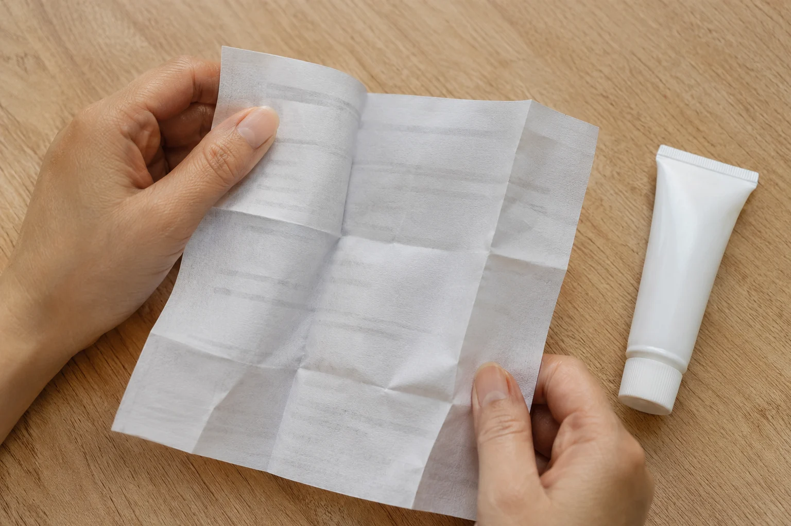

Chị tìm hoạt chất làm sáng nám, nhưng càng đọc càng thấy nhiều tên và không biết nên chọn gì trước. Giang muốn cùng chị gỡ từng câu hỏi: da đang chịu được đến đâu, bằng chứng nói gì và phần nào cần bác sĩ quyết định.

## Trước khi chọn hoạt chất làm sáng nám, cần biết điều gì?

Nếu còn lẫn lộn giữa nám và các mảng sạm khác, chị có thể xem bài [nám da là gì](/bai/nam-da-la-gi/) trước.

Hãy bắt đầu bằng một tờ giấy nhỏ. Chị ghi tên sữa rửa mặt, dưỡng ẩm, chống nắng và các sản phẩm đang bôi. Bên cạnh mỗi món, ghi lý do sử dụng. Nếu chưa trả lời được một sản phẩm đang làm nhiệm vụ gì, chị chưa cần thêm một sản phẩm khác để xử lý sự bối rối ấy.

Đây là cách Giang đề xuất sắp xếp thông tin, không phải phép thử chẩn đoán da. Một ảnh chụp hoặc lời quảng cáo về “nám chân sâu” không đủ để chị tự quyết phác đồ. Khi chưa rõ mảng sạm là gì, khám da liễu giúp xác định vấn đề trước khi chọn cách xử lý. [AAD: Chẩn đoán và điều trị nám](https://www.aad.org/public/diseases/a-z/melasma-treatment)

Với một sản phẩm mới, chị cũng nên tách hai kỳ vọng: dùng có phù hợp không và sắc tố có thay đổi không. Chai serum chưa làm da sáng hơn không có nghĩa là cần tăng lượng ngay; da rát cũng không phải bằng chứng serum đang chạm tới nám.

## Niacinamide có bằng chứng gì, và giới hạn ở đâu?

Một thử nghiệm nhỏ trên 27 người so sánh niacinamide 4% ở một bên mặt với hydroquinone 4% ở bên kia trong 8 tuần, cùng dùng chống nắng. Cả hai bên đều cải thiện; mức tốt đến rất tốt ghi nhận ở 44% với niacinamide và 55% với hydroquinone. Tác dụng phụ xuất hiện ở cả hai bên. Các con số này mô tả thử nghiệm, không phải hướng dẫn tự dùng hydroquinone. [Navarrete-Solís và cộng sự: Thử nghiệm niacinamide 4% so với hydroquinone 4%](https://pubmed.ncbi.nlm.nih.gov/21822427/)

Điểm chị cần giữ lại là cách đọc kết quả. “Có nghiên cứu” chưa trả lời được sản phẩm trên tay chị có giống công thức nghiên cứu hay không. Mẫu nhỏ và thời gian theo dõi ngắn cũng chưa cho biết kết quả dài hạn của mọi người.

Vì vậy, Giang không dùng nghiên cứu này để xếp niacinamide thành lựa chọn số một cho tất cả làn da. Cũng không lấy nồng độ của thử nghiệm làm đơn tự chăm sóc. Khi gặp một bảng quảng cáo đầy phần trăm, chị có thể hỏi lại: số này là nồng độ thành phần, tỷ lệ người cải thiện hay lời nhà bán tự mô tả? Ba điều ấy rất khác nhau.

## Vitamin C, tranexamic acid và arbutin nên hiểu thế nào?

AAD đề cập vitamin C như một lựa chọn bôi dịu hơn mà bác sĩ có thể cân nhắc trong kế hoạch điều trị; điều đó không chứng nhận mọi serum vitamin C đều làm mờ nám. Tranexamic acid cũng được đề cập, nhưng dạng uống là thuốc do bác sĩ kê. Người từng bị cục máu đông phải báo bác sĩ trước khi được cân nhắc thuốc này. Không suy từ tên chung rằng dạng bôi và dạng uống có thể thay thế nhau. [AAD: Chẩn đoán và điều trị nám](https://www.aad.org/public/diseases/a-z/melasma-treatment)

Để dễ đọc, chị có thể dùng bảng sau như bản đồ câu hỏi, không phải bảng xếp hạng mua sắm:

| Tên thường gặp | Câu hỏi cần làm rõ |
|---|---|
| Niacinamide | Nghiên cứu đang nói về công thức nào, có giống sản phẩm này không? |
| Vitamin C | Đây là mỹ phẩm chăm sóc hay một phần của kế hoạch bác sĩ hướng dẫn? |
| Tranexamic acid | Đang nói tới đường bôi hay đường uống, ai đánh giá mức phù hợp? |
| Arbutin | Có nguồn đáng tin cho chính công thức và mục đích sử dụng này chưa? |

Với arbutin, Giang chưa đưa hướng dẫn chọn dùng trong bài này vì phần bằng chứng được kiểm chứng chưa đủ. Để trống một lời khuyên còn tốt hơn ghép bốn hoạt chất thành một danh sách được gọi chung là “an toàn”.

Chị không cần mua đủ tên trong bảng. Mục đích của bảng là giúp chị biết câu nào nên hỏi khi đọc nhãn hoặc đi tư vấn.

*Ảnh minh hoạ tạo bằng AI*

## Bắt đầu thế nào để còn biết da phản ứng với điều gì?

Giang gợi ý một trình tự chuẩn bị ngắn:

1. [Chụp lại nhãn và hướng dẫn](/bai/cach-doc-bang-thanh-phan-my-pham/) của sản phẩm dự định dùng.
2. Ghi ngày bắt đầu, vùng dùng và các món khác đang có trong chu trình.
3. Thử sản phẩm theo hướng dẫn phù hợp trước khi dùng rộng.
4. Ghi nhận cảm giác trên da, đừng chỉ chụp màu của mảng nám.

AAD hướng dẫn bôi thử mỹ phẩm hai lần mỗi ngày ở vùng nhỏ mặt trong cánh tay hoặc khuỷu tay trong 7-10 ngày; nếu xuất hiện phản ứng thì rửa bỏ và ngừng dùng. Cách thử này giúp theo dõi khả năng dung nạp, không bảo đảm sẽ không dị ứng về sau và không thay chỉ định thuốc. [AAD: Thử sản phẩm chăm da](https://www.aad.org/public/everyday-care/skin-care-secrets/prevent-skin-problems/test-skin-care-products)

Một ví dụ giả định: chị đổi cùng lúc sữa rửa mặt, serum và kem dưỡng rồi thấy ngứa. Nhật ký có tên ba món vẫn hữu ích khi đi khám, nhưng sẽ khó biết món nào liên quan. Đó là lý do Giang thích cách thay đổi có ghi nhận, từng việc rõ ràng.

## Điều gì cần tránh, và khi nào nên nhờ bác sĩ?

Không nên coi bong tróc hay châm chích là một cột mốc bắt buộc phải vượt qua. Với da nám, sản phẩm gây kích ứng có thể làm đốm sẫm màu thêm. Chống nắng và chăm sóc dịu nhẹ vẫn là phần nền khi cân nhắc hoạt chất. [AAD: Tự chăm sóc da nám](https://www.aad.org/public/diseases/a-z/melasma-self-care)

Nếu đang được kê thuốc, chị mang cả danh sách mỹ phẩm đến lần tái khám. Hỏi rõ món nào giữ, món nào cần ngừng và khi nào đánh giá lại. Đừng tự thêm serum chỉ vì chưa thấy thay đổi như ảnh của người khác.

Giang mong chị ra khỏi bài này với một quyết định vừa sức: hiểu món mình định dùng trước khi bôi. Không có nghĩa chị phải tự trở thành người phân tích công thức. Khi thông tin vượt quá khả năng tự đánh giá, hỏi bác sĩ là một bước chăm da chủ động.

Bài viết chia sẻ thông tin chăm sóc da phổ thông, không thay thế khám và tư vấn của bác sĩ da liễu.

## Nguồn tham khảo

- [AAD: Chẩn đoán và điều trị nám](https://www.aad.org/public/diseases/a-z/melasma-treatment)
- [Navarrete-Solís và cộng sự: Thử nghiệm niacinamide 4% so với hydroquinone 4%](https://pubmed.ncbi.nlm.nih.gov/21822427/)
- [AAD: Thử sản phẩm chăm da](https://www.aad.org/public/everyday-care/skin-care-secrets/prevent-skin-problems/test-skin-care-products)
- [AAD: Tự chăm sóc da nám](https://www.aad.org/public/diseases/a-z/melasma-self-care)
