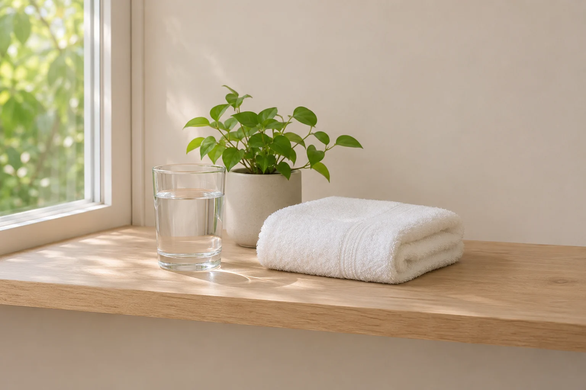

Rửa mặt xong da khô căng, chị có thể nghĩ mình vừa làm sạch rất kỹ. Nhưng nếu phải chờ bôi kem mới thấy dễ chịu, Giang muốn cùng chị xem lại bước rửa, trước khi quyết định mua thêm một món dưỡng.

Bài này chỉ bàn về cảm giác khó chịu sau làm sạch. Chị không cần tự xác định bệnh da hay tự gọi tên một thành phần gây hại để bắt đầu quan sát việc mình đang làm.

## Rửa mặt xong da khô căng có phải đã sạch hơn?

Trong hướng dẫn rửa mặt của Viện Da liễu Hoa Kỳ, điều được nhấn mạnh là làm sạch dịu và tránh chà xát. Hướng dẫn này không nhắc tới cảm giác căng như dấu hiệu da đã sạch. [AAD: Face washing 101](https://www.aad.org/public/everyday-care/skin-care-basics/care/face-washing-101)

Vì vậy, Giang không chọn sự kin kít làm đích đến cho bước rửa mặt. Đây là lựa chọn trong cách chăm mà Giang gợi ý, không phải một phép đo độ sạch.

Chị thử tách hai câu hỏi: mình đã làm đúng hướng dẫn của sản phẩm chưa, và sau đó da cảm thấy thế nào? Một câu nói về thao tác. Câu còn lại giúp chị mô tả sự khó chịu. Nếu nhập cả hai thành “càng căng càng sạch”, chị sẽ khó nhận ra lúc cần xem lại cách chăm.

Giang gợi ý dùng từ cụ thể hơn khi ghi chú: căng ở hai má, rát quanh miệng, hay chỉ thấy khác thường khi cười. Chị không phải chấm điểm làn da. Mục đích là có lời mô tả rõ hơn câu “da hôm nay không ổn”.

Cũng không cần kiểm tra bằng cách rửa thêm một lượt. Giang muốn lần làm sạch tiếp theo là một thao tác có chủ đích, chứ không trở thành cuộc thử xem da chịu được bao nhiêu.

## Vì sao cần nhìn lại cả cách rửa, không chỉ chai sữa rửa mặt?

Với da khô, AAD khuyên dùng sản phẩm làm sạch dịu, tránh nước nóng và dưỡng ẩm sau khi làm sạch. Đó là hướng chăm sóc chung, không xác định được riêng nguyên nhân của chị. [AAD: Chăm sóc da khô](https://www.aad.org/public/everyday-care/skin-care-basics/dry/dermatologists-tips-relieve-dry-skin)

Hãy hình dung bước rửa như một chuỗi việc: mở vòi nước, lấy sản phẩm, xoa trên da, rửa lại, lau mặt. Khi có điều gì khó chịu ở cuối chuỗi, việc chỉ nhìn chai mỹ phẩm có thể bỏ sót những thao tác còn lại. Giang dùng cách nhìn này để giúp chị kiểm tra có thứ tự, không phải để kết luận nguyên nhân.

Chị có vừa đổi sản phẩm không? Có hôm nào dùng thêm dụng cụ? Có rửa lại vì chưa thấy “đủ sạch”? Những câu hỏi ấy không đòi chị nhớ toàn bộ tháng vừa rồi. Hãy bắt đầu từ lần gần nhất chị còn nhớ rõ.

Nếu chưa biết đọc nhãn, chị có thể xem bài [cách đọc bảng thành phần mỹ phẩm](/bai/cach-doc-bang-thanh-phan-my-pham/). Ở đây, Giang không muốn chọn một tên thành phần rồi kết tội nó. Chỉ riêng việc có bọt, ít bọt hoặc ghi một mức pH chưa giải thích được cảm giác của một người cụ thể.

*Ảnh minh hoạ tạo bằng AI*

## Chị nên xem lại bước làm sạch theo thứ tự nào?

Giang gợi ý một lượt kiểm tra ngắn, có thể làm ngay khi chị chuẩn bị rửa mặt. Đây là cách sắp xếp thông tin, không phải một quy trình điều trị.

1. **Đọc việc sản phẩm được thiết kế để làm.** Phân biệt món làm sạch với món tẩy tế bào chết hoặc thuốc đang được kê. Nếu không hiểu hướng dẫn, giữ lại vỏ để hỏi người có chuyên môn.
2. **Nhìn lại thao tác.** AAD hướng dẫn dùng nước ấm vừa, đầu ngón tay và khăn mềm để thấm khô, thay vì kỳ cọ. [AAD: Cách rửa mặt](https://www.aad.org/public/everyday-care/skin-care-basics/care/face-washing-101)
3. **Ghi cảm giác sau đó.** Chị thấy căng ngay lúc lau khô hay sau khi thêm một món khác? Hãy ghi điều quan sát được, chưa cần viết “do sản phẩm này”.
4. **Giữ một câu hỏi chính.** Chẳng hạn, “Vì sao hai má cứ khó chịu sau bước rửa?” Câu hỏi rõ giúp cuộc trao đổi khi đi khám tập trung hơn.

Không nhất thiết phải mua dụng cụ đo, lập bảng dài hoặc chụp da mỗi ngày. Một dòng ghi trong điện thoại cũng được. Nếu việc theo dõi khiến chị chăm chăm nhìn gương, có thể rút gọn lại để việc chăm da vẫn vừa với ngày bận.

Ví dụ giả định: chị đổi sữa rửa mặt và khăn lau trong cùng một ngày. Khi thấy căng, hãy ghi cả hai thay đổi. Giang không thể từ ví dụ ấy nói món nào là thủ phạm; ghi đủ thông tin có ích hơn một kết luận vội.

## Dưỡng ẩm sau rửa có phải là che giấu vấn đề?

Dưỡng ẩm là một phần chăm sóc da khô, không phải dấu hiệu chị đã thất bại ở bước làm sạch. AAD khuyên thoa dưỡng ẩm khi da còn ẩm sau rửa hoặc tắm, và trao đổi với bác sĩ nếu khô kéo dài hay sản phẩm gây rát. [AAD: Chăm sóc da khô](https://www.aad.org/public/everyday-care/skin-care-basics/dry/dermatologists-tips-relieve-dry-skin)

Điều Giang muốn chị tránh là dùng kem như cách buộc mình chịu một bước rửa luôn gây khó chịu. Chị vẫn có thể dưỡng ẩm, đồng thời xem lại việc làm sạch. Hai việc ấy không loại trừ nhau.

Khi lựa chọn, hãy bắt đầu từ món chị đang có và hướng dẫn của nó. Đừng biến câu hỏi “da có đang khô không?” thành danh sách nhiều lớp dưỡng bắt buộc. Nếu một món khiến chị rát rõ, việc tiếp tục xếp thêm sản phẩm lên trên không giúp xác định vấn đề.

Chị đang dùng thuốc do bác sĩ kê thì nên hỏi người kê về cách phối hợp các bước. Bài viết này không hướng dẫn dừng hoặc đổi thuốc. Cảm giác khó chịu cần được đặt trong toàn bộ bối cảnh chăm sóc và điều trị của chị.

## Điều gì nên tránh khi cố tìm câu trả lời?

Trước hết, đừng lấy trải nghiệm của một người khác làm kết luận cho mình. Một chị thấy hợp một loại sữa rửa mặt không có nghĩa chị phải chịu cảm giác rát để dùng cho hết. Ngược lại, một lần khó chịu cũng chưa đủ để tuyên bố sản phẩm ấy không phù hợp với tất cả mọi người.

Giang cũng không muốn chị tự dán nhãn “hỏng hàng rào da” chỉ từ một buổi tối. Nếu dùng từ này để kể với bác sĩ, hãy nói thêm biểu hiện thật: xuất hiện lúc nào, ở đâu, có gì đi kèm. Mô tả giúp ích hơn việc cố chọn đúng thuật ngữ.

Nếu đồng thời có mụn, chị có thể đọc thêm [chăm da mụn tại nhà](/bai/cham-da-mun-tai-nha/). Tuy vậy, đừng tự nhập mọi lời khuyên của hai bài thành một lịch chăm mới. Câu hỏi trước mắt vẫn là bước nào đang khiến chị khó chịu và cần ai đánh giá.

## Khi nào cần đưa câu hỏi này tới bác sĩ?

Nếu các điều chỉnh cơ bản không giúp giải quyết khô, ngứa hoặc khó chịu, chị nên được bác sĩ da liễu đánh giá. Hướng dẫn về da khô của AAD cũng lưu ý việc cần khám khi tự chăm chưa đủ. [AAD: Khi cần hỗ trợ cho da khô](https://www.aad.org/public/everyday-care/skin-care-basics/dry/dermatologists-tips-relieve-dry-skin)

Nếu sau khi dùng sản phẩm chị bị sưng đột ngột ở môi, miệng, lưỡi hoặc họng, khó thở hay khó nuốt, hãy gọi cấp cứu ngay. Đừng chờ rửa mặt hoặc theo dõi thêm mới tìm trợ giúp. Đây có thể là dấu hiệu phản ứng dị ứng nghiêm trọng. [NHS: Dấu hiệu phản vệ cần cấp cứu](https://www.nhs.uk/conditions/anaphylaxis/)

Khi đi khám, chị có thể mang ảnh nhãn sản phẩm cùng dòng ghi chú đã chuẩn bị. Không cần chứng minh mình chăm da đúng hay sai. Buổi khám là để làm rõ điều chưa biết và tìm cách phù hợp với tình trạng thực tế.

Giang mong sau bài này, chị không còn dùng cảm giác căng như một bài kiểm tra độ sạch. Lần đứng trước bồn rửa tiếp theo, chỉ cần nhớ mục đích của bước đang làm và để ý sự dễ chịu của chính mình.

Bài viết chia sẻ thông tin chăm sóc da phổ thông, không thay thế khám và tư vấn của bác sĩ da liễu.

## Nguồn tham khảo

- [American Academy of Dermatology: Face washing 101](https://www.aad.org/public/everyday-care/skin-care-basics/care/face-washing-101).
- [American Academy of Dermatology: Dermatologists' top tips for relieving dry skin](https://www.aad.org/public/everyday-care/skin-care-basics/dry/dermatologists-tips-relieve-dry-skin).
- [NHS: Anaphylaxis](https://www.nhs.uk/conditions/anaphylaxis/).
