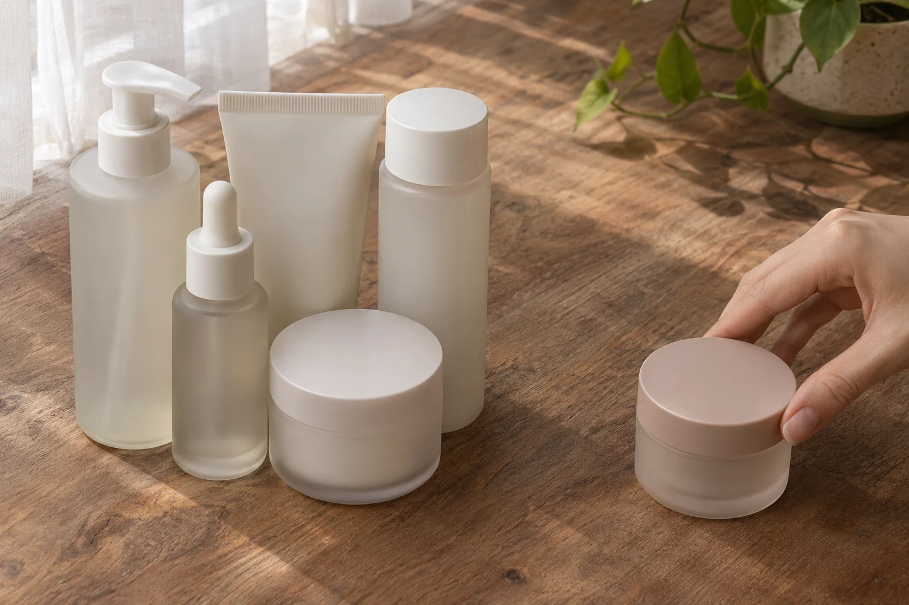

Đọc một danh sách sai lầm khi chăm da nám, chị có thể thấy gần như việc gì mình từng làm cũng bị chê. Giang muốn bài này giúp chị xem lại lựa chọn một cách bình tĩnh, để biết điều gì cần đổi và điều gì cần hỏi thêm.

## Sai lầm khi chăm da nám: bắt đầu từ kỳ vọng quá nhanh

Nếu chị chưa rõ tình trạng của mình, hãy bắt đầu từ bài [nám da là gì](/bai/nam-da-la-gi/) trước khi tự đánh giá cách chăm sóc.

Khi muốn da nhạt nhanh, chị dễ lấy tốc độ làm tiêu chí quan trọng nhất. Một lời hứa rõ ngày nghe thuyết phục hơn câu trả lời có điều kiện. Nhưng điều trị nám cần cân nhắc từng người; không có một cách tốt nhất phù hợp tất cả. [AAD: Chẩn đoán và điều trị nám](https://www.aad.org/public/diseases/a-z/melasma-treatment)

Giang gợi ý chị tạm bỏ câu “bao lâu sẽ đẹp như ảnh” và viết mục tiêu của mình bằng lời dễ hiểu. Chị muốn bớt lo về mảng sạm, biết chọn chăm sóc hay muốn bác sĩ đánh giá điều trị? Mục tiêu rõ giúp buổi tư vấn đi vào việc chị cần.

Khi chưa rõ kỳ vọng, mỗi món mới có thể lại mang theo một lời hẹn mới. Chị không cần tiếp tục vòng mua, chờ, thất vọng rồi mua chỉ để chứng minh mình đã cố.

*Ảnh minh hoạ tạo bằng AI*

## Chống nắng có đang bị xem như một món bôi cho đủ bước?

[Chống nắng cho da nám](/bai/chong-nang-cho-da-nam/) gồm cả sản phẩm phù hợp và cách bảo vệ trong sinh hoạt. AAD khuyên kết hợp kem chống nắng với bóng râm, mũ và các biện pháp che chắn. [AAD: Tự chăm sóc da nám](https://www.aad.org/public/diseases/a-z/melasma-self-care)

Thay vì chỉ ghi “có bôi”, chị có thể nhìn lại một ngày thực tế: lúc rời nhà, giờ đi ăn trưa, đoạn đường đón con. Đây là gợi ý rà lịch sinh hoạt, không phải cách tự chấm điểm điều trị.

Nếu kế hoạch khó thực hiện, chị ghi lại vướng mắc để điều chỉnh trong lần tư vấn.

## Da rát có phải là dấu hiệu đang xử lý được nám?

Không nên dùng cảm giác rát để chứng minh hiệu quả. AAD lưu ý kích ứng từ sản phẩm có thể làm đốm sẫm màu hơn. Chăm da nám không yêu cầu chị phải chịu đựng để vượt qua một cuộc thử thách. [AAD: Tự chăm sóc da nám](https://www.aad.org/public/diseases/a-z/melasma-self-care)

Giang gợi ý chị ghi nhận bằng lời cụ thể: rát ở đâu, xuất hiện sau món nào, kéo dài thế nào. Câu “da đang đẩy nám” là một cách diễn giải, còn những quan sát ấy mới là thông tin cần đem trao đổi.

Đừng để lời trấn an trên mạng thay đánh giá khi phản ứng kéo dài. Cũng đừng vội [thêm một sản phẩm mới](/bai/hoat-chat-lam-sang-nam/) chỉ để che cảm giác khó chịu của sản phẩm cũ. Khi chưa biết nguyên nhân, mình cần làm rõ vấn đề trước.

## Tự peel hoặc chọn laser theo ảnh trước sau có rủi ro gì?

DermNet lưu ý các thủ thuật như peel và laser có nguy cơ làm tình trạng sắc tố xấu hơn; lựa chọn cần thận trọng. Bài này không hướng dẫn thực hiện tại nhà, không gợi ý thông số hay số buổi. [DermNet: Melasma](https://dermnetnz.org/topics/melasma)

Trước khi quyết định, chị có thể chuẩn bị bốn câu hỏi:

1. Chẩn đoán hiện tại của tôi là gì?
2. Vì sao lựa chọn này phù hợp với trường hợp của tôi?
3. Có nguy cơ nào cần biết và ai xử lý nếu xảy ra?
4. Sau đó cần chăm sóc, theo dõi và duy trì ra sao?

Chị có quyền chưa quyết định trong lần nghe tư vấn đầu tiên. Một tấm ảnh trước sau không kể hết điều kiện chụp, các bước đã dùng và thời gian theo dõi. Không nên dùng nó thay phần giải thích dành cho chính mình.

## Nám nhạt rồi, vì sao vẫn cần xem lại kế hoạch?

Nám có thể tái phát. Vì vậy, một giai đoạn cải thiện không phải lời bảo đảm rằng mọi chăm sóc đều có thể dừng. [DermNet: Melasma](https://dermnetnz.org/topics/melasma)

Nếu nám đậm lại, chị hãy mang thông tin đã ghi để trao đổi thay vì tự trách. Có thể [kế hoạch cần được xem lại](/bai/kien-nhan-khi-cham-da/); điều đó không cho phép ai kết luận chị lười hay thiếu kiên trì chỉ bằng một ảnh chụp.

Điều Giang mong chị tránh nhất là đưa ra quyết định tiếp theo trong lúc quá thất vọng. Chị có thể dừng việc mua thêm, gom nhãn sản phẩm đang dùng và đặt một buổi tư vấn. Mỗi lần xem lại nên giúp kế hoạch rõ hơn, không làm chị sợ làn da của mình hơn.

Bài viết chia sẻ thông tin chăm sóc da phổ thông, không thay thế khám và tư vấn của bác sĩ da liễu.

## Nguồn tham khảo

- [AAD: Chẩn đoán và điều trị nám](https://www.aad.org/public/diseases/a-z/melasma-treatment)
- [AAD: Tự chăm sóc da nám](https://www.aad.org/public/diseases/a-z/melasma-self-care)
- [DermNet: Melasma](https://dermnetnz.org/topics/melasma)
