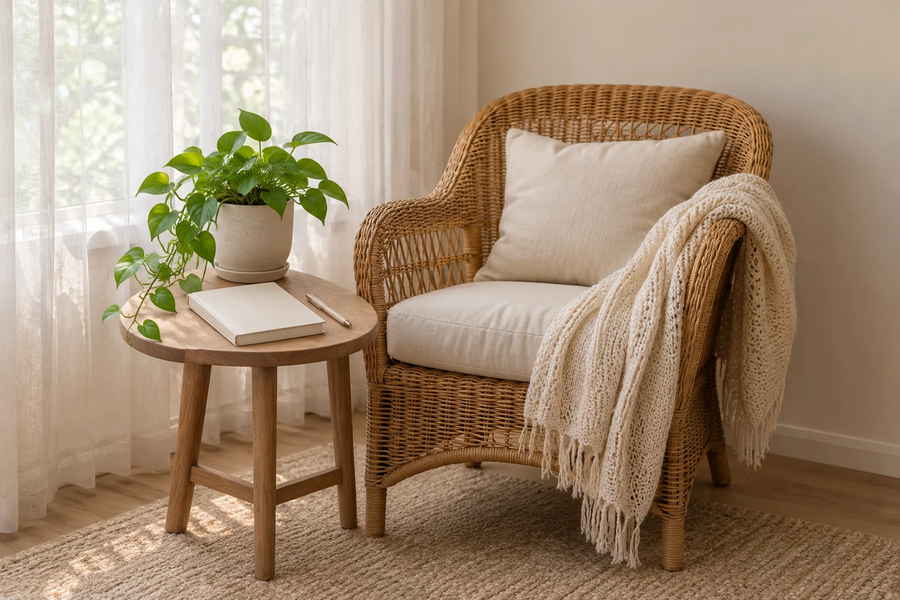

Tự ti về làn da đôi khi bắt đầu từ một lần nhìn người khác rồi quay lại thấy mình chưa đủ đẹp. Nếu chị đang mệt vì những lần so sánh như vậy, Giang muốn cùng chị ngồi lại với cảm giác ấy, chưa vội thêm một việc phải sửa.

Chị có thể muốn da mình dễ chịu hơn, đều màu hơn, đồng thời cũng muốn thôi khắt khe với bản thân. Hai mong muốn đó đều có chỗ trong cuộc trò chuyện này.

## Khi tự ti về làn da, chị đang cần điều gì nhất?

Giang muốn bắt đầu bằng một câu hỏi nhỏ: điều làm chị buồn lúc này là cảm giác trên da, một thay đổi chị chưa hiểu, hay ý nghĩ mình thua kém người khác? Chị không cần chọn ngay một câu trả lời duy nhất.

Nếu da đang đau hoặc khó chịu, chị cần hỗ trợ cho vấn đề cụ thể ấy. Nếu điều khiến chị nặng lòng là một lời nhận xét, có thể trước tiên chị cần được lắng nghe. Đặt tên cho nhu cầu không giải quyết mọi chuyện, nhưng giúp cuộc trò chuyện bớt lạc sang một danh sách mỹ phẩm.

Giang không muốn nói “đừng nghĩ nữa” rồi coi như đã an ủi xong. Khi chị đã buồn, thêm một yêu cầu phải vui ngay có thể không phải lời chị cần nghe. Ở đây, chị được phép nói mình chưa thấy ổn mà không phải chứng minh nỗi buồn đủ lớn.

Cũng không cần tìm một nguyên nhân hoàn chỉnh cho mọi lần so sánh. Chị có thể chỉ ghi nhận: hôm nay xem nội dung này xong, mình thấy khó chịu. Đó là quan sát của chị, chưa phải kết luận về sức khỏe tâm thần hay về người đăng nội dung.

## Có thể muốn chăm da mà không lấy người khác làm thước đo không?

Giang nghĩ chị có thể thử đổi câu hỏi. Thay vì “bao giờ mình được như người ấy?”, hãy hỏi “mình muốn hiểu điều gì trên da, và việc nào phù hợp với mình hôm nay?”. Đây là gợi ý suy ngẫm, không phải một kỹ thuật trị liệu.

Một câu trả lời có thể rất bình thường: [muốn biết vì sao da khó chịu sau rửa](/bai/rua-mat-xong-da-cang/), muốn đọc rõ nhãn món đang dùng, hoặc muốn đặt lịch khám cho vấn đề kéo dài. Những việc ấy có điểm bắt đầu và người hỗ trợ cụ thể. Chúng không đòi chị phải thắng một cuộc so sánh.

Chị cũng có thể viết riêng hai dòng: “điều tôi đang quan sát” và “điều tôi đang tự nói về mình”. Vết sạm ở má thuộc dòng đầu. Câu “mình kém cỏi vì chăm mãi không đẹp” thuộc dòng sau. Giang gợi ý tách chúng để chị dễ nhìn lại, không dùng tờ giấy ấy để chấm điểm tâm lý.

Nếu chưa muốn viết, chị bỏ qua cũng được. Bài này không giao thêm bài tập bắt buộc sau một ngày bận. Điều Giang muốn giữ là quyền lựa chọn cách chăm sóc không dựa hoàn toàn vào ánh nhìn của người khác.

*Ảnh minh hoạ tạo bằng AI*

## Khi xem nội dung về da làm chị mệt, nên thử thay đổi gì?

Giang đề xuất ba lựa chọn nhỏ. Chị có thể thử một việc phù hợp, không cần làm cả ba và cũng không có lời hứa rằng làm xong sẽ hết tự ti.

1. **Tạm dừng một luồng nội dung.** Nếu một tài khoản khiến chị thường xuyên thấy áp lực, chị có thể ẩn hoặc ngừng theo dõi một thời gian. Không cần tranh luận với người đăng để được phép rời đi.
2. **Đặt mục đích trước khi tìm.** Chẳng hạn, hôm nay chỉ tìm hiểu một câu hỏi về làm sạch. Khi đã đọc đủ để biết bước tiếp theo, chị có thể đóng trang thay vì tiếp tục xem hàng loạt ảnh so sánh.
3. **Chọn điều muốn mang theo sau khi đọc.** Một lời giải thích rõ, một câu hỏi cho bác sĩ hoặc cảm giác được tôn trọng đều có thể đáng giữ hơn một hình mẫu phải đạt tới.

Đây là đề xuất sắp xếp việc xem nội dung của Giang. Bài viết không khẳng định mạng xã hội là nguyên nhân duy nhất gây nỗi lo của chị, cũng không xem việc tắt điện thoại là cách điều trị.

NIMH khuyến khích dành thời gian cho hoạt động thư giãn, kết nối và xác định ưu tiên phù hợp khi chăm sóc tinh thần. Mỗi người có thể cần cách tự chăm khác nhau. [NIMH: Caring for Your Mental Health](https://www.nimh.nih.gov/health/topics/caring-for-your-mental-health)

Với ngày quá bận, chị có thể chọn một khoảng nghỉ vốn đã có: ngồi uống nước, nói chuyện với người thân hoặc đọc thứ mình thích. Giang đưa những ví dụ này như lựa chọn, không biến nghỉ ngơi thành một chỉ tiêu mới phải hoàn thành.

## Chị có cần yêu mọi điểm trên da ngay hôm nay không?

Giang không muốn đặt điều kiện đó. Chị có thể chưa thích một vết thâm và vẫn đối xử tử tế với bản thân. Chị cũng có thể quyết định đi khám hoặc chăm sóc thêm mà không xem khuôn mặt hiện tại là điều phải che giấu.

Có những ngày lời nói vừa sức nhất chỉ là: “Mình đang lo, mình cần hiểu thêm.” Chị không phải bước từ thất vọng sang tự tin trong một buổi đọc bài. Đây là lời mời nói với mình nhẹ hơn, không phải yêu cầu cảm xúc phải đổi theo ý muốn.

Nếu muốn trò chuyện với người thân, chị có thể nói rõ cần điều gì. Ví dụ một câu gợi ý: “Lúc này chị cần em nghe, chưa cần tìm mỹ phẩm giúp chị.” Đây là câu mẫu để chị chỉnh theo cách nói của mình, không phải lời kể về một cuộc trò chuyện có thật.

Bài [chăm sóc bản thân không ích kỷ](/bai/cham-soc-ban-than-khong-ich-ky/) bàn rộng hơn về việc dành chỗ cho nhu cầu riêng. Còn ở đây, Giang chỉ mong chị đừng buộc mình phải thay đổi ngoại hình trước rồi mới cho phép bản thân tham gia cuộc sống.

## Khi nào nỗi lo đã vượt khỏi một ngày thiếu tự tin?

Nếu có ý nghĩ làm hại bản thân, chị hãy tìm trợ giúp ngay và nói với một người đáng tin. Nếu có nguy cơ hành động ngay hoặc không giữ được an toàn, hãy nhờ người ở cùng và đưa tới khoa cấp cứu gần nhất, hoặc gọi dịch vụ cấp cứu tại nơi chị đang ở. Đừng ở một mình trong lúc nguy hiểm. NIMH hướng dẫn tìm hỗ trợ khi có ý nghĩ tự sát và gọi cấp cứu trong tình huống đe dọa tính mạng; các số điện thoại trên trang của họ dành cho Hoa Kỳ. [NIMH: Tìm trợ giúp khẩn cấp](https://www.nimh.nih.gov/health/topics/caring-for-your-mental-health)

Nếu việc lo về ngoại hình chiếm nhiều thời gian hoặc ảnh hưởng công việc, gặp gỡ và các mối quan hệ, chị nên tìm đánh giá chuyên môn. NHS đề cập những ảnh hưởng này trong thông tin về rối loạn mặc cảm ngoại hình. Nhưng có lúc so sánh không đồng nghĩa chị mắc rối loạn đó. [NHS: Body dysmorphic disorder](https://www.nhs.uk/mental-health/conditions/body-dysmorphia/)

Giang không dùng một danh sách biểu hiện trên mạng để đặt tên tình trạng cho chị. Điều đáng quan tâm ở đây là nỗi lo đang lấy đi bao nhiêu phần cuộc sống và chị có đang cần thêm hỗ trợ hay không.

Chị có thể bắt đầu bằng bác sĩ hoặc chuyên gia sức khỏe tâm thần đủ chuyên môn, kể đúng việc đang xảy ra. NIMH khuyên tìm hỗ trợ khi có triệu chứng nặng hoặc gây khó chịu, ảnh hưởng chức năng thường ngày. [NIMH: Khi cần hỗ trợ chuyên môn](https://www.nimh.nih.gov/health/topics/caring-for-your-mental-health)

Nếu đồng thời có vấn đề da, chị cũng có thể trao đổi với bác sĩ da liễu. Chăm sóc sức khỏe tinh thần không có nghĩa phủ nhận điều đang xảy ra trên da. Chị không phải lựa chọn chỉ được quan tâm một trong hai.

## Hôm nay, một bước vừa sức có thể là gì?

Giang gợi ý chị chọn một việc mà không cần chờ mình tự tin hoàn toàn: viết câu hỏi cho buổi khám, nói với người tin cậy rằng mình đang buồn, hoặc ngừng xem một nội dung đang khiến mình quá tải.

Nếu chưa chọn được việc nào, chị có thể chỉ đọc tới đây rồi nghỉ. Không cần biến bài viết thành thêm một thước đo xem mình đã chăm tinh thần tốt hay chưa. Những gợi ý trên chỉ là điểm bắt đầu để chị cân nhắc.

Giang muốn việc chăm da giữ được sự tận tình với chính người đang chăm. Chị vẫn có thể mong làn da thay đổi, nhưng cuộc sống và sự tôn trọng dành cho chị không cần đợi tới ngày mọi vết trên da đều như ý.

Bài viết chia sẻ thông tin phổ thông, không thay thế đánh giá của bác sĩ hoặc chuyên gia sức khỏe tinh thần.

## Nguồn tham khảo

- [National Institute of Mental Health: Caring for Your Mental Health](https://www.nimh.nih.gov/health/topics/caring-for-your-mental-health).
- [NHS: Body dysmorphic disorder](https://www.nhs.uk/mental-health/conditions/body-dysmorphia/).
