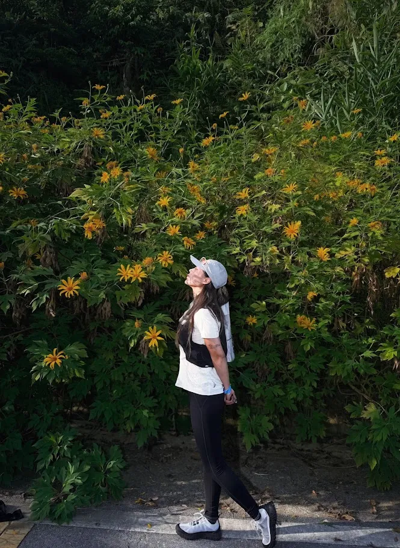
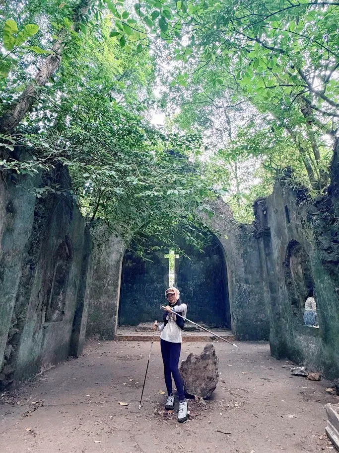
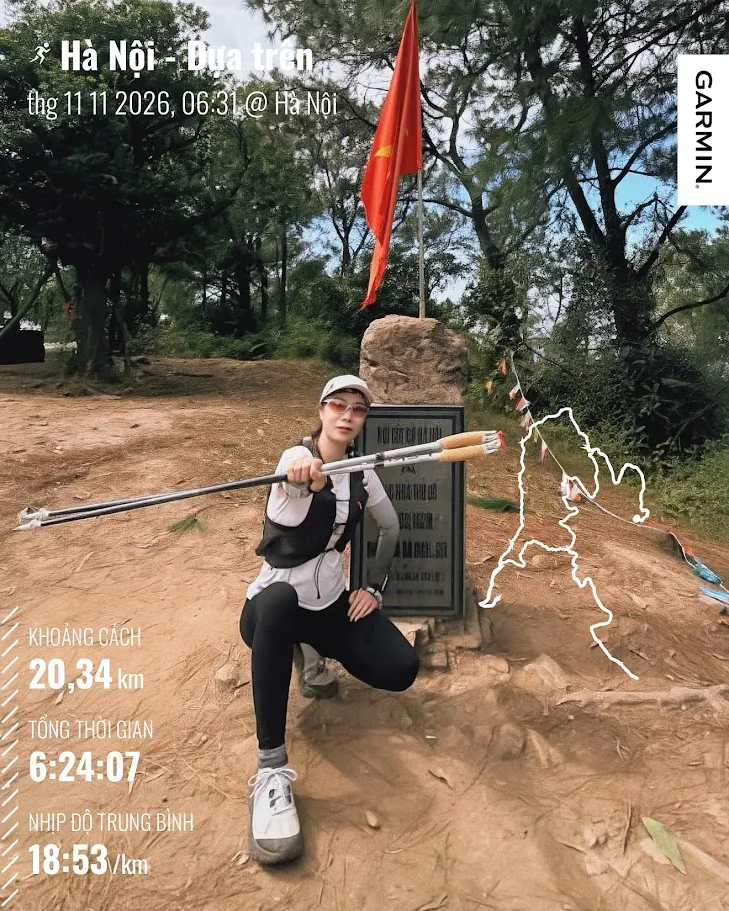

Trên đỉnh núi Hàm Lợn có một cột mốc đá ghi dòng chữ "Nóc nhà Thủ đô, cao độ 462m", cạnh một lá cờ đỏ bay trong gió. Chuyến trail Hàm Lợn này, đồng hồ của Giang ghi lại 20,34 km, tổng thời gian 6 giờ 24 phút. Bài này là những tấm ảnh và con số Giang muốn kể với chị, mở đầu chuyên mục Sống khỏe.

## Đường lên Hàm Lợn mùa dã quỳ

Hàm Lợn nằm ở Sóc Sơn, ngoại thành Hà Nội. Mùa này, hai bên đường lên núi là những bụi dã quỳ cao quá đầu người, nở vàng rực dưới nắng sớm.

Có những đoạn đường chỉ muốn dừng lại thật lâu. Trail cho mình cái quyền đó: không ai bắt chị phải chạy liên tục, chị được đi, được nghỉ, được ngước lên nhìn một bông hoa.

## Nhà thờ cổ giữa rừng

Trên đường đi có một nhà thờ cổ đã đổ mái. Tường đá phủ rêu xanh, cây rừng mọc vươn qua những ô cửa vòm, phía cuối chỉ còn một ô cửa hình thánh giá để ánh sáng lọt qua.

## 20,34 km trong hơn 6 tiếng

Lên tới đỉnh, Giang chụp lại tấm ảnh bên cột mốc 462m, kèm số liệu từ đồng hồ: quãng đường 20,34 km, tổng thời gian 6:24:07, nhịp độ trung bình 18 phút 53 giây cho mỗi km.

Gần 19 phút cho một km, nếu so với chạy đường phố thì rất chậm. Nhưng trail không đo bằng tốc độ. Đường núi có dốc đá, có đất trơn, có những đoạn phải chống gậy mà bước từng bước. Điều quan trọng là đi đến cuối, và về nhà an toàn.

Chuyện này cũng giống chăm da: không có đường tắt, chỉ có đi đều và đủ lâu. Giang đã viết về điều đó trong bài [kiên nhẫn với làn da](/bai/kien-nhan-voi-lan-da/).

## Vận động đều đặn mang lại gì cho chị?

Theo Tổ chức Y tế Thế giới (WHO), vận động thể chất đều đặn giúp giảm triệu chứng trầm cảm, lo âu, tốt cho não bộ và cải thiện cảm giác khỏe khoắn nói chung. Người trưởng thành được khuyến nghị vận động cường độ vừa phải ít nhất 150 phút mỗi tuần.

Chị không cần leo núi 20 km để đạt con số đó. Đi bộ nhanh 30 phút mỗi ngày, 5 ngày một tuần là đã đủ. Trail chỉ là một cách Giang chọn để vận động, và để được ở giữa thiên nhiên một chút sau những ngày bận rộn.

## Nếu chị muốn thử trail lần đầu

Cục Vườn quốc gia Hoa Kỳ (NPS) có bộ lời khuyên an toàn khi đi bộ đường núi, Giang tóm lại những điều hợp với người mới:

1. **Biết giới hạn của mình.** Chọn cung đường dễ, ngắn cho lần đầu. Đường dễ vẫn có cảnh đẹp.
2. **Để lại lịch trình.** Báo cho một người thân không đi cùng biết chị đi đâu, đi với ai, mấy giờ dự kiến về.
3. **Đi cùng nhau.** Để người đi chậm nhất giữ nhịp cho cả đoàn, không ai bị bỏ lại phía sau.
4. **Mang đủ nước** cho cả ngày và đừng cố quá sức.
5. **Chống nắng kỹ.** Bôi kem chống nắng trước khi đi, bôi lại khoảng mỗi 2 giờ và ngay sau khi ra nhiều mồ hôi. Đội mũ, mặc áo dài tay mỏng. Chi tiết trong bài [chống nắng cho da bị nám](/bai/chong-nang-cho-da-bi-nam/).

Và sau một ngày vận động dài, hãy cho cơ thể ngủ một giấc thật đủ. Vì sao giấc ngủ quan trọng với cả làn da, chị đọc thêm bài [ngủ đủ để da đẹp](/bai/ngu-du-da-dep/).

## Nguồn tham khảo
- [World Health Organization: Physical activity fact sheet](https://www.who.int/news-room/fact-sheets/detail/physical-activity)
- [U.S. National Park Service: Hike Smart](https://www.nps.gov/articles/hiking-safety.htm)
- [American Academy of Dermatology: How to apply sunscreen](https://www.aad.org/public/everyday-care/sun-protection/shade-clothing-sunscreen/how-to-apply-sunscreen)
